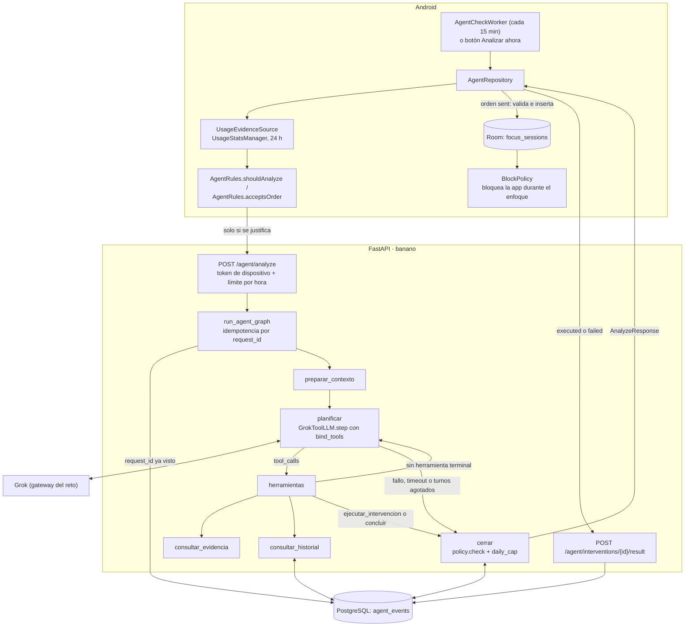

# Reporte técnico · Hito 2: herramientas reales

## 1. Información general

| | |
|---|---|
| **Proyecto** | La vida no es un banano (`LaVidaNoEsUnBanano`): bloqueador de apps para Android con agentes de IA |
| **Reto y organización** | Reto Agente 2026, PLATICA MX ([reto.pltk.mx](https://reto.pltk.mx/)), Track 1 |
| **Hito documentado** | S2 · Herramientas reales ("3 herramientas y video de 2 min") |
| **Objetivo del reporte** | Documentar, con evidencia rastreable al código y a las pruebas, las tres herramientas del agente de intervención, su integración y el estado de cumplimiento del hito |
| **Fecha de elaboración** | 2026-10-24 |
| **Rama y commit inspeccionados** | `production`, `f088114` (más la rama local `desarrollo` para la especificación y el historial detallado) |

**Estado de implementación**

| Verificado en este reporte | Pendiente o no verificable desde el repositorio |
|---|---|
| Las tres herramientas existen en el código y están conectadas al grafo del agente. | Las 10 ejecuciones que pide el reto: agregadas el 2026-11-07 en [s2-ejecuciones.md](s2-ejecuciones.md), exportadas de `agent_events` en producción. |
| 122 pruebas del backend pasan y 1 se omite (contrato de Postgres sin `TEST_DATABASE_URL`). | El video de 2 minutos del hito S2: agregado el 2026-11-10, [youtu.be/lcLKj5QDe-Y](https://youtu.be/lcLKj5QDe-Y). |
| 15 pruebas JVM de Android pasan (`AgentRulesTest`, `UsageSessionsTest`, `BlockPolicyTest`). | Una ejecución real contra Grok (`smoke_grok`) y contra PostgreSQL: no se ejecutaron para este reporte. |
| `ruff check` sin hallazgos en `banano` y `tests`. | Funcionamiento en un teléfono físico con el APK 0.3.0. |

## 2. Objetivo del Hito 2

El sitio del reto define así el entregable de la semana 2: *"3 herramientas, manejo de errores, 10 ejecuciones y video de 2 minutos."* (consultado el 2026-10-24).

La especificación interna del hito (`SPEC_S2.md`, rama `desarrollo`) concreta el objetivo: pasar de un flujo de decisiones predefinidas a un agente que **observa evidencia real, elige qué herramientas necesita, actúa dentro de límites explícitos y registra lo que ocurrió**, incluida la decisión de no actuar. Exige además que las herramientas hagan trabajo real (sección 7: *"No son válidas funciones que solo devuelvan datos estáticos, simulen una consulta o describan una acción que nunca se ejecuta"*) y que el flujo no llame siempre a las tres (sección 9).

En el código, esto se traduce en un tercer grafo de LangGraph, el agente de intervención (`POST /agent/analyze`). Grok decide en cada turno, con llamadas nativas a herramientas (`bind_tools`), si consulta el uso del teléfono, si consulta el historial o si termina. Para terminar puede proponer una sesión de enfoque o concluir sin intervenir.

| Herramienta | Contribución al agente |
|---|---|
| `consultar_evidencia_uso` | Le da al modelo datos medidos por Android en lugar de suposiciones. Sin ella, la política rechaza cualquier intervención (`no_evidence`). |
| `consultar_historial_intervenciones` | Memoria persistente por dispositivo: qué se intentó antes y cómo terminó. |
| `ejecutar_intervencion` | La única acción con efecto: una sesión de enfoque que el teléfono aplica y confirma. |

## 3. Arquitectura e integración

El backend no puede enviar órdenes al teléfono porque no hay push. Por eso el teléfono inicia el análisis, la orden viaja en la respuesta y el teléfono confirma después con una segunda llamada.



Recorrido de una solicitud:

1. **Disparo en Android.** `AgentCheckWorker` se ejecuta cada 15 minutos con red ([AgentCheckWorker.kt](../android/app/src/main/kotlin/com/lavidanoesunbanano/app/service/agent/AgentCheckWorker.kt)) y llama a `AgentRepository.analyzeIfNeeded()`. `AgentRules.shouldAnalyze` solo deja pasar la solicitud si hay permiso de uso, no hay una sesión de enfoque activa, pasaron 30 minutos desde el último análisis y las apps de la lista suman 20 minutos en la última hora ([AgentRules.kt](../android/app/src/main/kotlin/com/lavidanoesunbanano/app/domain/agent/AgentRules.kt)). El botón "Analizar ahora" llama a `analyzeNow()` y se salta estas reglas.
2. **Petición.** `AgentRepository.request` arma un `AnalyzeRequest` con un `request_id` nuevo, la hora local, las apps de la lista, el fin de la sesión de enfoque activa y la instantánea de uso de 24 h.
3. **Endpoint.** `analyze` ([routes.py:91](../backend/banano/api/routes.py#L91)) exige el token de dispositivo y aplica un límite propio de 12 análisis por hora (`rate_limit_agent_per_hour`).
4. **Idempotencia.** `run_agent_graph` ([agent_graph.py:291](../backend/banano/graphs/agent_graph.py#L291)) busca el `request_id`. Si ya existe, `replay` devuelve lo guardado sin llamar al LLM.
5. **Grafo.** `preparar_contexto` arma los mensajes con el prompt `AGENT_SYSTEM`. `planificar` pide un turno a Grok con las cuatro clases de `TOOLS` y `tool_choice="required"`. `herramientas` ejecuta las llamadas y alterna con `planificar` hasta que llega una herramienta terminal, se agotan los 3 turnos o se pasan los 20 s.
6. **Cierre.** `cerrar` ([agent_graph.py:161](../backend/banano/graphs/agent_graph.py#L161)) valida con la política, guarda el evento en `agent_events` y arma la `AnalyzeResponse`.
7. **Aplicación y confirmación.** Si la intervención llega como `sent`, Android la valida otra vez con `AgentRules.acceptsOrder`, inserta la sesión en Room, notifica y confirma `executed` o `failed`. `BlockPolicy` bloquea las apps objetivo mientras dure la sesión ([BlockPolicy.kt:57](../android/app/src/main/kotlin/com/lavidanoesunbanano/app/domain/blocking/BlockPolicy.kt#L57)).

### Registro de herramientas

Las herramientas son modelos de Pydantic: el nombre de la clase es el nombre que ve Grok, y su docstring y sus `Field` forman la descripción y el esquema.

```python
# backend/banano/agent/tools.py:53-55
READ_TOOLS = (consultar_evidencia_uso, consultar_historial_intervenciones)
TERMINAL_TOOLS = (ejecutar_intervencion, concluir)
TOOLS = {tool.__name__: tool for tool in READ_TOOLS + TERMINAL_TOOLS}
```

```python
# backend/banano/llm/client.py:116-117
# "required": cada turno es una herramienta; el texto suelto no sirve para decidir.
bound = self._model.bind_tools(tools, tool_choice="required")
```

> **Discrepancia registrada.** El README y `SPEC_S2.md` hablan de tres herramientas, pero el modelo recibe cuatro: la cuarta es `concluir` ([tools.py:44](../backend/banano/agent/tools.py#L44)). `concluir` no consulta datos ni ejecuta nada; sirve para terminar con `no_action` o `insufficient_evidence`. Esto coincide con la especificación, que dice que *"no intervenir puede ser una decisión del agente sin convertirse en una orden ficticia"*. En este reporte se trata como herramienta de control y no como una de las tres herramientas del hito.

## 4. Documentación de las herramientas

### 4.1 `consultar_evidencia_uso`

| | |
|---|---|
| **Propósito** | Devolver los minutos y aperturas por app en una ventana de tiempo, medidos por Android |
| **Problema que resuelve** | Que el agente decida sobre uso medido y no supuesto, y que distinga "sin uso" de "sin permiso" |
| **Esquema (lo que ve Grok)** | `class consultar_evidencia_uso` en [tools.py:14](../backend/banano/agent/tools.py#L14) |
| **Lógica** | `consultar_evidencia(usage, args)` en [tools.py:58](../backend/banano/agent/tools.py#L58) |
| **Fuente de datos** | `UsageEvidenceSource` ([UsageEvidenceSource.kt](../android/app/src/main/kotlin/com/lavidanoesunbanano/app/data/system/UsageEvidenceSource.kt)) y `UsageSessions` ([UsageSessions.kt](../android/app/src/main/kotlin/com/lavidanoesunbanano/app/domain/usage/UsageSessions.kt)) |
| **Invocación** | `herramientas`, rama `isinstance(args, consultar_evidencia_uso)` en [agent_graph.py:109](../backend/banano/graphs/agent_graph.py#L109) |

**Parámetros de entrada**

| Parámetro | Tipo | Restricción | Descripción |
|---|---|---|---|
| `ventana_minutos` | `int` | `15 ≤ x ≤ 1440` | Minutos hacia atrás desde `collected_at_ms` |
| `apps` | `list[str] \| None` | Máximo 20 elementos; por defecto `None` | Paquetes o nombres visibles. Vacío o `None` incluye todas las apps |

**Procedimiento**

1. **En el teléfono.** `UsageEvidenceSource.collect` comprueba el permiso con `usageAccessAllowed`. Si falta, el estado es `PERMISSION_MISSING`. Si no, lee 24 h de `UsageStatsManager.queryEvents` y conserva solo `ACTIVITY_RESUMED` y `ACTIVITY_PAUSED`, sin la propia app. Una `SecurityException` también se traduce en `PERMISSION_MISSING`.
2. `UsageSessions.fromEvents` empareja cada *resume* con su *pause*. Si otra app pasa al frente, se cierra la sesión anterior. Si una app sigue abierta, su sesión termina en el momento de la lectura.
3. `UsageSessions.minimize` conserva las apps de la lista del usuario más las 5 apps ajenas con más uso, hasta 300 sesiones (las más recientes), y marca `truncated` si recortó.
4. La instantánea viaja como `UsageSnapshot` en el cuerpo de `/agent/analyze`, validada con `extra="forbid"` ([schemas/agent.py](../backend/banano/schemas/agent.py)).
5. **En el backend**, cuando Grok la invoca, `consultar_evidencia` hace lo siguiente:
   - Si `usage.status != "ok"`, devuelve solo `{"status": usage.status}`, es decir, `permission_missing` o `error`.
   - Filtra las apps por paquete o nombre, sin distinguir mayúsculas.
   - Cuenta solo la parte de cada sesión que cae dentro de la ventana (`min(fin, collected_at) - max(inicio, desde)`).
   - Acumula los minutos y las aperturas por paquete, ordena de mayor a menor uso y redondea a un decimal.
   - Si no queda nada, devuelve `no_data`.
6. Si el resultado es `ok`, el grafo lo guarda en `state["evidence"]`. La política exige esa evidencia para aprobar una intervención, y `cerrar` persiste las 10 apps con más uso en `evidence_summary`.

**Salida**

```json
{
  "status": "ok",
  "ventana_minutos": 60,
  "fuente": "android_usage",
  "truncated": false,
  "apps": [
    {"package": "tiktok", "label": "TikTok", "category": "", "minutos": 25.0, "aperturas": 2},
    {"package": "chrome", "label": "chrome", "category": "", "minutos": 5.0, "aperturas": 1}
  ]
}
```

El ejemplo corresponde a la entrada `{"ventana_minutos": 60}` sobre tres sesiones: TikTok hace 50 min (10 min), TikTok hace 20 min (15 min) y Chrome hace 40 min (5 min). Es el caso de `test_suma_minutos_y_aperturas_en_la_ventana`. Las otras salidas posibles son `{"status": "permission_missing"}`, `{"status": "error"}` y `{"status": "no_data", "ventana_minutos": 60, "fuente": "android_usage"}`.

**Errores y casos límite**

- Si los argumentos no pasan la validación (por ejemplo, `ventana_minutos=5`), `herramientas` responde a Grok con `{"status": "error", "error": "argumentos inválidos: N"}` y el agente puede corregirse en el turno siguiente. Lo prueba `test_unknown_tool_and_bad_args_are_reported_and_the_agent_continues`.
- Cero uso (`no_data`) y falta de permiso (`permission_missing`) son estados distintos. Lo prueba `test_cero_uso_no_es_falta_de_permiso`.

**Limitaciones comprobadas en el código**

- **La evidencia la aporta el teléfono.** El backend no puede verificarla por su cuenta; `SPEC_S2.md` lo reconoce.
- **`aperturas` cuenta sesiones dentro de la ventana, no lanzamientos.** `fromEvents` une dos *resume* seguidos de la misma app en una sola sesión, y una sesión que cruza el borde de la ventana cuenta como una apertura.
- **La lista `apps` no valida la longitud de cada elemento.** Solo limita la cantidad de elementos.

**Pruebas**

| Archivo | Pruebas |
|---|---|
| [test_agent_tools.py](../backend/tests/test_agent_tools.py) | `test_suma_minutos_y_aperturas_en_la_ventana`, `test_recorta_la_sesion_que_empezo_antes_de_la_ventana`, `test_filtra_por_paquete_o_nombre`, `test_cero_uso_no_es_falta_de_permiso` |
| [test_agent_graph.py](../backend/tests/test_agent_graph.py) | `test_permission_missing_ends_in_insufficient_evidence`, `test_unknown_tool_and_bad_args_are_reported_and_the_agent_continues` |
| `UsageSessionsTest.kt` (Android) | 4 pruebas de emparejamiento y minimización |

### 4.2 `consultar_historial_intervenciones`

| | |
|---|---|
| **Propósito** | Devolver las intervenciones anteriores del mismo dispositivo con su estado real |
| **Problema que resuelve** | Evitar repetir acciones que no funcionaron y no confundir "ordenada" con "aplicada" |
| **Esquema** | `class consultar_historial_intervenciones` en [tools.py:24](../backend/banano/agent/tools.py#L24) |
| **Lógica** | `consultar_historial(store, device_id, args, now, confirm_window)` en [tools.py:87](../backend/banano/agent/tools.py#L87) |
| **Persistencia** | `InterventionStore.recent` y `PostgresStore` en [store.py:130](../backend/banano/agent/store.py#L130); tabla `agent_events` en [001_agent_events.sql](../backend/sql/001_agent_events.sql) |
| **Invocación** | `herramientas`, rama `isinstance(args, consultar_historial_intervenciones)` |

**Parámetros de entrada**

| Parámetro | Tipo | Restricción |
|---|---|---|
| `limite` | `int` | Por defecto 5; `1 ≤ x ≤ 10` |

Grok no puede elegir el `device_id`. Lo pone el grafo a partir del token autenticado (`state["device_id"]`), así que un dispositivo no puede leer el historial de otro.

**Procedimiento**

1. Ejecuta `store.recent(device_id, limite)`. En Postgres es `SELECT * FROM agent_events WHERE device_id = %s ORDER BY created_at DESC LIMIT %s`, y el índice `agent_events_device_created` cubre esa consulta.
2. Si la consulta lanza `StoreError` (error de psycopg, `OSError` o timeout de `db_timeout_s = 5 s`), devuelve `{"status": "unavailable"}`.
3. Si no hay filas, devuelve `{"status": "no_data"}`.
4. Si hay filas, transforma cada una a `fecha`, `decision`, `accion`, `estado` y `politica`. El `estado` se calcula con `effective_status`: una intervención `sent` sin confirmar después de `agent_confirm_window_s = 120 s` se lee como `unknown` ([store.py:58](../backend/banano/agent/store.py#L58)).

**Salida (ilustrativa, con la forma que produce el código)**

```json
{
  "status": "ok",
  "intervenciones": [
    {
      "fecha": "2026-10-23T21:40+00:00",
      "decision": "intervene",
      "accion": {"type": "start_focus_session", "duration_minutes": 10, "target_apps": ["com.zhiliaoapp.musically"]},
      "estado": "unknown",
      "politica": null
    }
  ]
}
```

**Errores y casos límite**

- Falta la base de datos: sin `DATABASE_URL`, `get_store` usa `UnconfiguredStore`, cuyas operaciones fallan como una base caída. El agente sigue funcionando, pero no puede enviar órdenes.
- Las tablas se crean solas: `PostgresStore` aplica `schema_sql()` (con `IF NOT EXISTS`) en la primera conexión.
- Neon con PgBouncer: el timeout se aplica con `asyncio.wait_for` y no con `statement_timeout`, porque el pooler rechaza ese parámetro (commit `c6fe1cc`).

**Limitaciones**

- **Una conexión nueva por consulta.** Está marcado en el código como `shortcut:` ([store.py:131](../backend/banano/agent/store.py#L131)).
- **`observed_outcome` existe en la tabla pero nunca se llena.** El historial no puede decir si una intervención mejoró el uso.

**Pruebas**

| Archivo | Pruebas |
|---|---|
| [test_store.py](../backend/tests/test_store.py) | `test_memory_store_contract`, `test_postgres_store_applies_the_schema_once`, `test_unconfirmed_sent_reads_as_unknown` y `test_postgres_store_contract` (**omitida** sin `TEST_DATABASE_URL`) |
| [test_agent_graph.py](../backend/tests/test_agent_graph.py) | `test_andres_evidence_history_and_focus_session_is_sent` (historial vacío: `no_data`), `test_store_down_history_is_unavailable_and_nothing_is_sent` |

### 4.3 `ejecutar_intervencion`

| | |
|---|---|
| **Propósito** | Pedir al teléfono una sesión de enfoque que bloquee ciertas apps durante unos minutos |
| **Problema que resuelve** | Actuar de forma proporcional, dentro de límites que el modelo no puede cambiar, y saber si la acción ocurrió de verdad |
| **Esquema** | `class ejecutar_intervencion` en [tools.py:31](../backend/banano/agent/tools.py#L31), con `extra="forbid"` |
| **Validación** | `policy.check` y `policy.resolve_targets` en [policy.py](../backend/banano/agent/policy.py); cupo diario en `cerrar` |
| **Aplicación** | `AgentRepository.apply` y `AgentRules.acceptsOrder` (Android) |
| **Confirmación** | `confirm_intervention` en [routes.py:103](../backend/banano/api/routes.py#L103) y `PostgresStore.confirm` |

**Parámetros de entrada**

| Parámetro | Tipo | Restricción |
|---|---|---|
| `duration_minutes` | `int` | El esquema acepta cualquier `int`; la política solo permite 5, 10, 15, 20 o 30 |
| `target_apps` | `list[str]` | Entre 1 y 10 elementos; paquetes o nombres visibles |
| `reason` | `str` | Máximo 400 caracteres; se limpia y se recorta a 240 con `short_reason` |

**Procedimiento**

1. **En `herramientas`**, la llamada se rechaza con `"Primero revisa los resultados; luego termina."` si llega en el mismo turno que una herramienta de lectura o después de otra terminal. Si es válida, se guarda como `terminal` y el grafo pasa a `cerrar`.
2. **En `cerrar`, `policy.check`** ([policy.py:22](../backend/banano/agent/policy.py#L22)) devuelve el primer código que aplique, en este orden:

   | Código | Cuándo se aplica |
   |---|---|
   | `no_evidence` | `consultar_evidencia_uso` no devolvió `ok` en este análisis |
   | `duration_not_allowed` | La duración no está en `ALLOWED_DURATIONS` |
   | `target_not_allowed` | Alguna app no está en `blocked_apps`; los nombres visibles se resuelven a paquetes y se quitan los duplicados |
   | `focus_already_active` | `focus_active_until_ms` es mayor que `collected_at_ms` |

3. **Cupo diario.** Si la política aprueba, `count_interventions_since` cuenta las intervenciones `sent`, `executed` y `failed` de las últimas 24 h. Con 4 o más (`agent_daily_interventions`), el código es `daily_cap`. Si la base falla, el código es `store_unavailable`.
4. **Estado.** Queda `rejected` si hay código y `sent` si no. El evento se guarda en `agent_events`. Si no se puede guardar, un `sent` se convierte en `rejected` con `store_unavailable`: sin registro no hay idempotencia ni forma de confirmar.
5. **En Android**, `AgentRepository.call` solo aplica intervenciones con `status == "sent"` y un `id`. `AgentRules.acceptsOrder` vuelve a comprobar la duración y que las apps estén en la lista local. Si pasa, inserta `FocusSessionEntity` en Room y muestra una notificación. Después llama a `POST /agent/interventions/{id}/result` con `executed`, o con `failed` y `error_code: "invalid_order"`.
6. **Confirmación.** `PostgresStore.confirm` solo actualiza las filas que siguen en `sent` y que pertenecen a ese dispositivo, por lo que repetir la confirmación no cambia nada. Una fila desconocida o de otro dispositivo devuelve 404, y una base caída devuelve 503.

**Salida**

Grok recibe `{"status": "ok", "nota": "recibido"}`; el resultado real va en la respuesta HTTP al teléfono. Este ejemplo sigue la forma de `AnalyzeResponse` en el caso de `test_andres_evidence_history_and_focus_session_is_sent`:

```json
{
  "decision": "intervene",
  "reason": "Llevas 32 minutos en TikTok en la última hora, en tu rato de estudio.",
  "steps": [
    {"tool": "consultar_evidencia_uso", "args": {"ventana_minutos": 60}, "status": "ok", "ms": 0},
    {"tool": "consultar_historial_intervenciones", "args": {"limite": 5}, "status": "no_data", "ms": 0},
    {"tool": "ejecutar_intervencion", "args": {"type": "start_focus_session", "duration_minutes": 10, "target_apps": ["com.zhiliaoapp.musically"]}, "status": "sent", "ms": 0}
  ],
  "intervention": {
    "id": "<uuid del evento>",
    "type": "start_focus_session",
    "duration_minutes": 10,
    "target_apps": ["com.zhiliaoapp.musically"],
    "status": "sent",
    "policy_code": null
  },
  "persisted": true,
  "replayed": false
}
```

**Errores y casos límite**

- **`sent` no significa aplicada.** Si el teléfono no confirma en 120 s, la intervención se lee como `unknown` en `replay` y en el historial.
- **El teléfono no reintenta la confirmación.** Si falla por `IOException` o `HttpException`, se ignora a propósito y el backend verá `unknown`.

**Limitaciones**

- **Solo existe un tipo de intervención** (`start_focus_session`). Las demás candidatas de la especificación (advertencia, pausa, mantener un bloqueo) no están implementadas.
- **El cupo diario no es atómico.** Se cuenta antes de guardar, sin bloqueo de fila, así que dos análisis simultáneos del mismo dispositivo podrían superarlo por uno. Lo mitigan el límite de 12 análisis por hora y los 30 minutos de enfriamiento en Android. Este riesgo se dedujo del código y no se reprodujo.
- **El enfriamiento de Android vive en memoria.** Se reinicia si el sistema mata el proceso; está marcado como `shortcut:` en `AgentRepository`.

**Pruebas**

| Archivo | Pruebas |
|---|---|
| [test_agent_graph.py](../backend/tests/test_agent_graph.py) | `test_andres_…_is_sent`, `test_intervening_without_evidence_is_rejected_by_policy`, `test_policy_rejects_duration_and_apps_outside_the_list`, `test_daniela_focus_already_active_and_daily_cap`, `test_terminating_in_the_same_turn_as_reading_is_not_allowed`, `test_store_down_…`, `test_same_request_id_replays_without_calling_the_llm` |
| [test_agent_api.py](../backend/tests/test_agent_api.py) | `test_analyze_then_confirm_executed`, `test_another_device_cannot_confirm`, `test_without_database_nothing_is_sent`, `test_analyze_needs_a_device_token`, `test_analyze_rejects_unknown_fields`, `test_agent_has_its_own_rate_limit` |
| `AgentRulesTest.kt` (Android) | `orders outside the list or with odd durations are refused` y 3 pruebas de `shouldAnalyze` |

## 5. Flujo de ejecución conjunto

El código no fija ninguna secuencia: Grok decide en cada turno qué herramientas llama. El grafo solo impone estas reglas:

- **Máximo 3 turnos del LLM** (`agent_max_cycles`), cada uno de hasta 6 s, y 20 s en total. Si se agotan, la decisión es `agent_unavailable` con `error_code` igual a `max_cycles` o `timeout` (prueba `test_loop_is_capped`).
- **Varias herramientas por turno.** Grok puede pedir varias en el mismo turno; se ejecutan en orden dentro de `herramientas`.
- **No se termina a ciegas.** Una herramienta terminal pedida en el mismo turno que una de lectura se rechaza, porque terminar ahí sería decidir sin haber visto los datos.
- **Intervenir exige evidencia.** Sin `consultar_evidencia_uso` con resultado `ok`, `ejecutar_intervencion` siempre termina en `no_evidence`.
- **El historial es opcional.** La política no lo exige; el prompt solo le dice a Grok que lo consulte "cuando te sirva".
- **Respuestas sin herramientas.** Si Grok responde sin llamar a ninguna, el resultado es `agent_unavailable` con `invalid_output`. Si llama a una herramienta desconocida, recibe `unknown_tool` y puede seguir.

Secuencias que demuestran las pruebas (con un LLM falso que reproduce las decisiones):

| Caso | Secuencia | Resultado |
|---|---|---|
| Andrés | evidencia, historial, intervención | `intervene` con estado `sent` |
| Carlos | evidencia, `concluir` | `no_action`, sin historial ni ejecución |
| Sin permiso | evidencia (`permission_missing`), `concluir` | `insufficient_evidence` |
| Base caída | evidencia, historial (`unavailable`), intervención | `rejected` con `store_unavailable` |

## 6. Tecnologías utilizadas

| Capa | Tecnología | Uso en las herramientas |
|---|---|---|
| Backend | Python 3.12, FastAPI | Endpoints `/agent/analyze` y `/agent/interventions/{id}/result` |
| Orquestación | LangGraph (`StateGraph`, `Runtime`) | Grafo `preparar_contexto`, `planificar`, `herramientas`, `cerrar` |
| LLM | `langchain-xai` (`ChatXAI`) con Grok a través del gateway del reto | `bind_tools` con `tool_choice="required"`. Usa el modelo `GROK_MODEL_JUDGE`, sin reintentos |
| Validación | Pydantic | Esquemas de las herramientas, `AnalyzeRequest`/`AnalyzeResponse` con `extra="forbid"` |
| Persistencia | PostgreSQL (Neon en producción, servicio `db` de `docker-compose.yml` en local), psycopg 3 asíncrono | `agent_events` |
| Android | Kotlin, `UsageStatsManager`, WorkManager, Room, Retrofit, Hilt | Evidencia, disparo periódico, sesión de enfoque, llamadas HTTP |
| Pruebas | pytest, JUnit (JVM), ruff | Sección 7 |

## 7. Pruebas y validación

### Pruebas ejecutadas para este reporte

| Comando | Resultado |
|---|---|
| `uv run pytest -q` (en `backend/`) | **122 passed, 1 skipped** en 2.32 s |
| `uv run pytest -q tests/test_agent_tools.py tests/test_agent_graph.py tests/test_agent_api.py tests/test_store.py -rs` | **26 passed, 1 skipped** en 0.83 s. Omitida: `tests\test_store.py:66: sin TEST_DATABASE_URL` |
| `android\gradlew.bat -p android :app:testDebugUnitTest --tests "*AgentRulesTest" --tests "*UsageSessionsTest" --tests "*BlockPolicyTest"` (con `JAVA_HOME` en el JBR de Android Studio) | **BUILD SUCCESSFUL**. Según los XML de resultados: `AgentRulesTest` 4/4, `UsageSessionsTest` 4/4 y `BlockPolicyTest` 7/7, sin fallos |
| `uv run ruff check banano tests` | `All checks passed!` |

No se encontraron errores.

### Pruebas existentes que no se ejecutaron

| Prueba | Motivo |
|---|---|
| `test_postgres_store_contract` | Requiere un PostgreSQL real (`docker compose up -d db` y `TEST_DATABASE_URL`) |
| `scripts/smoke_grok.py --solo herramientas` y `smoke_grok --api <URL>` (casos Andrés y Carlos de punta a punta) | Llaman al gateway real y consumen créditos del reto; requieren las credenciales de `backend/.env` |

### Qué cubren las pruebas automatizadas

Todas las pruebas del grafo y de la API usan dobles de prueba: `FakeToolLLM` reproduce las decisiones de Grok y `MemoryStore` reemplaza a Postgres ([tests/fakes.py](../backend/tests/fakes.py)). Demuestran la lógica de las herramientas, la política y el manejo de errores.

**No demuestran** que Grok elija bien las herramientas, que el gateway responda a tiempo, ni que el contrato con Postgres funcione: esto último se cubriría con la prueba omitida.

### Comprobaciones pendientes

- Ejecución de punta a punta contra Grok y Postgres reales, con evidencia guardada: resuelto el 2026-11-07 con filas de `agent_events` en [s2-ejecuciones.md](s2-ejecuciones.md).
- Las 10 ejecuciones que pide el reto: resuelto el 2026-11-07 en [s2-ejecuciones.md](s2-ejecuciones.md).
- Prueba en un dispositivo físico: permiso de uso, sesión de enfoque aplicada y confirmación `executed`.

## 8. Cumplimiento de los requisitos del hito

Los requisitos oficiales vienen del sitio del reto: *"3 herramientas, manejo de errores, 10 ejecuciones y video de 2 minutos."* Las filas marcadas "SPEC" vienen de las pruebas de aceptación de `SPEC_S2.md` (sección 15), que es un documento interno del proyecto y no un requisito oficial.

| Requisito | Implementación encontrada | Evidencia verificable | Estado |
|---|---|---|---|
| **Oficial:** 3 herramientas | `consultar_evidencia_uso`, `consultar_historial_intervenciones`, `ejecutar_intervencion`, más `concluir` como control | `tools.py`, `agent_graph.py`, `test_agent_tools.py`, `test_agent_graph.py` | Cumplido en código y pruebas con dobles |
| **Oficial:** manejo de errores | `permission_missing`, `no_data`/`unavailable`, argumentos inválidos, `unknown_tool`, `agent_unavailable` (`llm_unavailable`, `timeout`, `max_cycles`, `invalid_output`), códigos de política, `unknown` por falta de confirmación, 401/404/422/429/503 | `test_agent_graph.py`, `test_agent_api.py`, `test_store.py` (pasan) | Cumplido en pruebas |
| **Oficial:** 10 ejecuciones | Exportación de `agent_events` de producción: 34 ejecuciones de 5 teléfonos al 2026-11-07 (38 de 6 al 2026-11-10), 10 seleccionadas que cubren los cuatro resultados | [s2-ejecuciones.md](s2-ejecuciones.md) (agregado el 2026-11-07) | Cumplido |
| **Oficial:** video de 2 minutos | Video de 1:58 grabado en vivo contra producción (agregado el 2026-11-10) | [youtu.be/lcLKj5QDe-Y](https://youtu.be/lcLKj5QDe-Y) | Cumplido |
| SPEC 1: herramientas conectadas a operaciones reales | `UsageStatsManager`, `SELECT` en Postgres, sesión en Room confirmada | Código Android y backend | Cumplido en código; no verificado en vivo |
| SPEC 2: no se invocan todas las herramientas siempre | Selección con `bind_tools`, sin secuencia fija | `test_carlos_legit_use_ends_without_history_or_execution` | Cumplido (con LLM falso) |
| SPEC 3: un caso con intervención y otro sin | `intervene` y `no_action` | Pruebas Andrés y Carlos | Cumplido (con LLM falso) |
| SPEC 6: toda acción pasa por validación determinista | `policy.check`, `daily_cap`, `AgentRules.acceptsOrder` | `test_policy_rejects_…`, `test_daniela_…`, `AgentRulesTest` | Cumplido |
| SPEC 7: se distingue lo solicitado de lo confirmado | `sent` frente a `executed`/`failed`/`unknown` | `test_analyze_then_confirm_executed`, `test_unconfirmed_sent_reads_as_unknown` | Cumplido |
| SPEC 9: el modo local funciona sin Internet | El bloqueo no depende del backend; el worker exige red | Código (`BlockPolicy`, restricción de red en `AgentCheckWorker`) | Parcial: no hay prueba automatizada del modo sin conexión |
| SPEC 10: no hay secretos en el cliente | La llave del gateway solo vive en el backend | `test_no_secrets.py` (pasa) | Cumplido en el repositorio |
| SPEC 12: la demostración muestra herramientas, decisión y resultado real | Las 3 herramientas, la decisión, `executed`, el error `permission_missing` y su recuperación | [Video](https://youtu.be/lcLKj5QDe-Y) | Cumplido |

## 9. Limitaciones y mejoras futuras

### Problemas comprobados en el código o en el repositorio

1. **La especificación y el historial del hito no están publicados.** `SPEC_S2.md` y los commits detallados del agente (`7cab805`, `f89795a`, `41b7790`, `c31c6e3`) solo existen en la rama local `desarrollo`: `git branch -r --contains` no devuelve ninguna rama remota, y `origin/desarrollo` apunta a `e7cc4c6`. En GitHub, el único rastro público es el commit aplastado `f9760fe` de `production`.
2. **El modelo ve cuatro herramientas** y la documentación habla de tres (sección 3).
3. **`observed_outcome` nunca se llena.** No se mide si la intervención redujo el uso.
4. **Solo hay un tipo de intervención** (`start_focus_session`).
5. **Las confirmaciones perdidas no se reintentan.** El resultado queda como `unknown`; es un comportamiento documentado, no un fallo oculto.
6. **El valor de `aperturas` es aproximado** (sección 4.1).
7. **Una conexión a Postgres por consulta.** Son 3 o 4 conexiones por análisis, y está marcado como `shortcut:`.
8. ~~No hay video ni ejecuciones reales del hito.~~ Resuelto: ejecuciones en [s2-ejecuciones.md](s2-ejecuciones.md) (2026-11-07) y [video](https://youtu.be/lcLKj5QDe-Y) (2026-11-10).

### Riesgos deducidos del código, sin reproducir

- El cupo diario no es atómico (sección 4.3).
- La evidencia de uso la aporta el cliente: un cliente modificado podría inventarla. Lo mitigan el token de dispositivo y la doble validación en Android.

### Recomendaciones (no implementadas)

- Publicar la rama `desarrollo` o copiar `SPEC_S2.md` a `docs/`, para que el evaluador pueda rastrear los commits del hito.
- Actualizar el README para mencionar `concluir`.
- Hacer atómico el cupo diario, por ejemplo contando e insertando dentro de una misma transacción.
- Llenar `observed_outcome` con el uso de la ventana siguiente a la intervención.

## 10. Evidencias y referencias

**Código**

- Herramientas: [backend/banano/agent/tools.py](../backend/banano/agent/tools.py)
- Política: [backend/banano/agent/policy.py](../backend/banano/agent/policy.py)
- Persistencia: [backend/banano/agent/store.py](../backend/banano/agent/store.py), [backend/sql/001_agent_events.sql](../backend/sql/001_agent_events.sql)
- Grafo: [backend/banano/graphs/agent_graph.py](../backend/banano/graphs/agent_graph.py)
- Cliente LLM: [backend/banano/llm/client.py](../backend/banano/llm/client.py) (`GrokToolLLM`, `build_agent_llm`)
- Prompt: [backend/banano/llm/prompts.py](../backend/banano/llm/prompts.py) (`AGENT_SYSTEM`, `agent_request_text`)
- Contrato: [backend/banano/schemas/agent.py](../backend/banano/schemas/agent.py)
- Endpoints: [backend/banano/api/routes.py](../backend/banano/api/routes.py)
- Configuración (sin secretos): [backend/banano/config.py](../backend/banano/config.py), líneas 62 a 69
- Android: `AgentRepository.kt`, `AgentRules.kt`, `AgentCheckWorker.kt`, `UsageEvidenceSource.kt`, `UsageSessions.kt` y `BlockPolicy.kt`, bajo `android/app/src/main/kotlin/com/lavidanoesunbanano/app/`

**Pruebas**

- Backend: `backend/tests/test_agent_tools.py`, `test_agent_graph.py`, `test_agent_api.py`, `test_store.py` y `fakes.py`
- Android: `android/app/src/test/kotlin/com/lavidanoesunbanano/app/domain/AgentRulesTest.kt`, `UsageSessionsTest.kt` y `BlockPolicyTest.kt`

**Commits**

Públicos (rama `production` en GitHub):

- [`f9760fe`](https://github.com/sergioRepository/ProyectoPlatica/commit/f9760fe81f73925e900a7bc02388cf25979eef2d): versión de producción con el agente. Es el commit que el README asocia a S2.
- `8f3ab39`: las tablas se crean solas. `c6fe1cc`: conexión con el pooler de Neon. `d3bcb6c`: APK 0.3.0.

Solo locales (rama `desarrollo`, sin publicar):

- `da899fa`: prueba de llamadas nativas en `smoke_grok`.
- `7cab805`: evidencia de uso.
- `f89795a`: historial en Postgres y herramientas nativas.
- `41b7790`: sesión de enfoque confirmada en Android.
- `c31c6e3`: `SPEC_S2.md`.
- `137799c`: APK 0.3.0.

PENDIENTE: publicar esa rama si se quieren enlazar estos commits.

**Otros documentos**

- `README.md`, sección "Hito 2".
- `SPEC_S2.md`, solo en la rama local `desarrollo`.
- Requisitos oficiales: [reto.pltk.mx](https://reto.pltk.mx/).

**Pendientes**

- Video de demostración S2: [youtu.be/lcLKj5QDe-Y](https://youtu.be/lcLKj5QDe-Y).
- Evidencia de las 10 ejecuciones: [s2-ejecuciones.md](s2-ejecuciones.md), exportación de `agent_events` sin `device_id`.
- Nota de entrega del hito: PENDIENTE: agregar enlace.

## 11. Conclusión

El agente de intervención tiene tres herramientas reales:

- **`consultar_evidencia_uso`** trabaja sobre el uso que mide `UsageStatsManager` en el teléfono.
- **`consultar_historial_intervenciones`** consulta la tabla `agent_events` en PostgreSQL.
- **`ejecutar_intervencion`** propone una sesión de enfoque que el backend valida y Android aplica y confirma.

Grok elige las herramientas con llamadas nativas (`bind_tools`), sin una secuencia fija. Una cuarta herramienta de control, `concluir`, le permite terminar sin actuar. Ninguna acción se ejecuta sin pasar por la política determinista del backend y por la validación de Android, y el sistema distingue "ordenada" (`sent`) de "aplicada" (`executed`) y de "sin confirmar" (`unknown`).

El manejo de errores está implementado y cubierto por pruebas que pasan: 122 en el backend (1 omitida) y 15 en Android. Esas pruebas usan dobles del LLM y de la base de datos.

**Para dar el hito por documentado y validado ante el reto faltan:**

1. Una corrida de la prueba de contrato contra Postgres real.
2. Publicar la especificación y los commits detallados del hito, que hoy solo existen en la rama local `desarrollo`.
